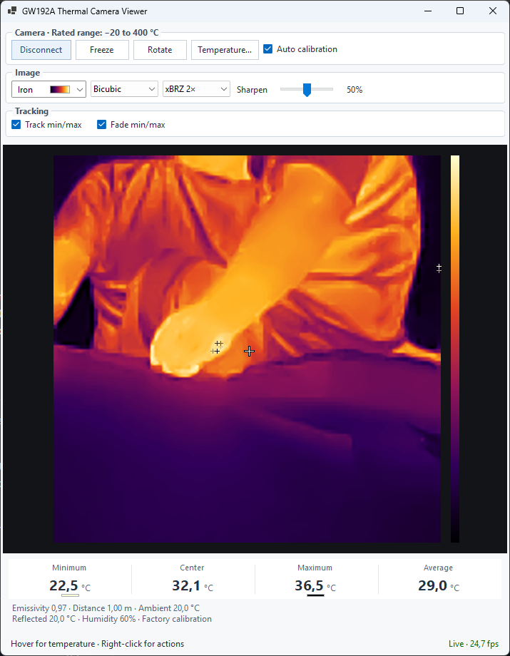

# GW192A Thermal Camera Viewer

A lightweight Windows viewer for the GW192A USB thermal camera.



## Requirements

- Windows x64
- [.NET 10 Desktop Runtime](https://dotnet.microsoft.com/download/dotnet/10.0)
- A connected GW192A camera

Run `GW192A.ThermalCameraViewer.exe`. The viewer connects automatically.
Close other applications using the camera if the connection fails.

## Features

- Live thermal image with minimum, maximum, average, and spot temperatures.
- Color palettes, image rotation, scaling, and adjustable sharpening.
- Optional min/max tracking with fading position trails.
- Freeze/resume and camera-controlled automatic calibration.
- Copy temperature readings or connection diagnostics from the right-click menu.

## Controls

| Action | Control |
|---|---|
| Move the measurement cross | Left-click the image |
| Reset it to center | Double-click, or use the right-click menu |
| Freeze / resume | Button or **Ctrl+Space** |
| Rotate clockwise | Button or **Ctrl+R** |
| Temperature settings | Button or **Ctrl+T** |
| Copy temperature readings | Right-click menu or **Ctrl+Shift+C** |

The **Camera**, **Image**, and **Tracking** groups contain related controls.
Display adjustments do not alter measured temperatures.
The Camera heading shows the manufacturer's rated measurement range: **−20 °C
to 400 °C**. This specification is separate from the live readings; the color bar
shows relative image contrast, not a fixed scale across the rated range.

## Temperature readings

The viewer reads factory calibration from the connected camera. Emissivity,
distance, ambient/reflected temperature, and humidity affect measurements and
can be adjusted under **Temperature…**.

Unavailable readings display **—**. **≤** and **≥** indicate calibration-range
limits; **≈** indicates an average containing range-limited values.
Brief image pauses during automatic calibration are normal. Changing the
automatic-calibration checkbox changes a camera setting that is not restored
when the viewer closes.

Absolute measurement accuracy has not been independently certified. This app
is not a medical thermometer or a certified measurement instrument.

## Build and test

Requires the .NET 10 SDK.

```powershell
dotnet build IRCamera/GW192A.ThermalCameraViewer.csproj -c Release
dotnet run --project IRCamera.Tests/GW192A.ThermalCameraViewer.Tests.csproj -c Release
dotnet publish IRCamera/GW192A.ThermalCameraViewer.csproj -c Release -o artifacts/app
```

Publishing produces one framework-dependent Windows x64 executable. It does
not bundle .NET. Include the accompanying dependency license notices when
distributing it. Tests run without camera hardware.

See [THIRD-PARTY-NOTICES.md](THIRD-PARTY-NOTICES.md) for dependency licenses and
[RELEASE-CHECKLIST.md](RELEASE-CHECKLIST.md) for distribution requirements.
